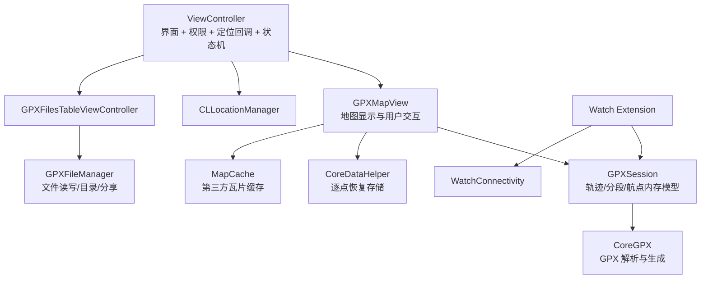

# iOS Open GPX Tracker 源码分析

## 1. 分析基线

- 官方仓库：`https://github.com/merlos/iOS-Open-GPX-Tracker`
- 本地参考副本：`ios-reference/`
- 分支：`master`
- 分析提交：`cd0954ffcd5ae688b76f8b796607c98ea5c6a0eb`
- 提交日期：2026-06-30
- iOS 应用版本：1.10.1
- 主应用部署目标：iOS 12.0
- 语言/界面：Swift 5、UIKit、Storyboard
- 许可证：GPL-3.0-or-later

## 2. 产品功能范围

主应用围绕一个地图记录页面展开，支持：

- 开始、暂停、继续和重置轨迹记录；
- 在当前位置或地图长按位置添加航点；
- 编辑、拖动、删除航点；
- 显示经纬度、海拔、速度、定位精度、方向、耗时和距离；
- 导入、打开、继续编辑、保存、删除和分享 GPX 文件；
- Apple 地图、卫星图、OpenStreetMap、CartoDB、OpenTopoMap 和 OpenSeaMap；
- 对第三方瓦片地图进行浏览缓存，离线时复用已浏览区域；
- 崩溃或进程被杀后的未保存轨迹恢复；
- 自定义 GPX 文件目录、单位、活动类型、文件名日期格式、常亮和比例尺；
- Apple Watch 独立记录以及向 iPhone 传输 GPX 文件；
- 13 种本地化资源目录，包括简体中文。

## 3. 当前架构



它是一个典型的早期 UIKit 单体应用，而不是 MVVM/Clean Architecture：

- `ViewController.swift` 约 1554 行，同时承担 UI 构建、交互、定位权限、位置回调、记录状态和文件操作协调；
- `GPXMapView` 同时承担地图渲染、瓦片源切换、航点操作、轨迹更新和恢复存储调用；
- `GPXSession` 是最接近纯领域层的部分，保存轨迹、分段和航点并计算距离；
- `CoreDataHelper` 不是正式轨迹库，而是“当前未保存会话”的崩溃恢复日志；
- 完成的 GPX 文件直接保存在 Documents 或用户选择的安全作用域目录；
- 偏好设置通过 `UserDefaults` 保存。

因此安卓端应复刻功能和行为，不应照搬类边界。

## 4. 核心记录流程

### 状态机

`GpxTrackingStatus` 只有三个状态：

1. `notStarted`：清空地图、计时器、当前会话和恢复数据库；
2. `tracking`：开始计时并接收位置点；
3. `paused`：停止计时，将非空当前段封存，然后创建新段。

状态变化为：

```text
notStarted --开始--> tracking --暂停--> paused --继续--> tracking
      ^                     |                         |
      +--------重置---------+-------------------------+
```

暂停/继续会形成新的 GPX `trkseg`。继续打开已有文件时，旧轨迹被保留，新采集内容追加到最后一个轨迹结构中。

### 定位采集

`CLLocationManager` 使用：

- `desiredAccuracy = kCLLocationAccuracyBest`；
- `distanceFilter = 2m`；
- `headingFilter = 3°`；
- 禁止系统自动暂停；
- 允许后台位置更新；
- 活动类型可配置。

收到位置后，应用总是更新经纬度、海拔、速度、精度指示和地图中心；只有处于 `tracking` 时才把点加入轨迹。每个点会同时进入：

- `GPXSession.currentSegment` 内存模型；
- Core Data 恢复存储；
- 地图折线 overlay。

距离使用相邻点间的地球表面距离累计，分别维护总距离、当前 track 距离和当前 segment 距离。

### GPX 结构

- 航点：`wpt`；
- 一次连续记录：`trkseg`；
- 一次保存期间的多个分段：`trk`；
- 继续编辑旧文件时保留旧 `trk`，并为本次记录构建/扩展最后的轨迹；
- GPX 解析与 XML 生成交给 CoreGPX 0.9.3+。

## 5. 数据与持久化

### 最终文件

`GPXFileManager` 负责 `.gpx` 文件：

- 默认写入应用 Documents；
- 可以用系统文档选择器指定自定义目录；
- 文件列表按修改时间倒序；
- 支持导入、删除、分享和覆盖保存；
- 文件名默认由可配置日期格式生成。

### 会话恢复

Core Data SQLite 只保存当前会话恢复信息：

- `CDTrackpoint`：经纬度、海拔、时间、点序号、分段序号、序列化对象；
- `CDWaypoint`：经纬度、海拔、时间、名称、描述、序号；
- `CDRoot`：上次文件名、最后分段号、保存后是否继续。

每收到一个轨迹点就异步创建子 context 并落库。应用下次启动时重组 segment，并加载到地图继续记录。

## 6. 地图与离线能力

- Apple MapKit 是原生底图；
- 其他底图通过 URL tile overlay 接入；
- MapCache 对用户已经浏览的瓦片进行缓存；
- 当前实现不是“选择区域并完整下载”的离线地图包，而是被动缓存；
- OpenSeaMap 是透明叠加层，其余第三方瓦片替换底图；
- 各地图源有独立最大缩放级别、子域名和瓦片尺寸。

安卓端需要特别遵守各瓦片服务的使用政策、署名、User-Agent、请求频率和离线缓存限制。不能把公共 OSM tile server 当作无限制离线下载源。

## 7. Android 对照设计

| iOS | Android 建议 | 说明 |
|---|---|---|
| UIKit + Storyboard | Jetpack Compose | 重做界面和状态管理 |
| `ViewController` | `TrackerViewModel` + Compose Screen | 拆开 UI、权限和业务逻辑 |
| `CLLocationManager` | Android 系统 LocationManager + Foreground Service | 后台持续定位必须显示常驻通知 |
| `GPXSession` | 纯 Kotlin `RecordingSession` | 保留三态状态机与 segment 语义 |
| Core Data | Room | 保存当前会话、点、段和航点，支持恢复 |
| MapKit | MapLibre Native | 支持 OSM/自定义 raster tile 与离线扩展 |
| MapCache | MapLibre 缓存或受控 tile cache | 明确缓存上限与服务条款 |
| CoreGPX | 自有轻量 GPX 1.1 parser/writer 或成熟 Kotlin 库 | 必须做兼容样例测试 |
| UserDefaults | DataStore Preferences | 保存单位、地图源等设置 |
| UIDocumentPicker | Storage Access Framework | 导入、导出、自定义目录 |
| UIActivityViewController | Android Sharesheet + FileProvider | 分享 GPX 文件 |
| WatchConnectivity | 暂不纳入 MVP；后续 Wear OS Data Layer | 独立阶段实现 |

### 推荐安卓模块边界

```text
app/
  ui/                 Compose 页面和组件
  tracking/           前台定位服务、状态机、采样策略
  domain/             Track、Segment、TrackPoint、Waypoint
  data/room/           未保存会话与恢复
  data/gpx/            GPX 解析、序列化和兼容测试
  map/                 MapLibre、图层、瓦片源和缓存
  files/               SAF 导入导出与分享
  settings/            DataStore
```

## 8. 不应原样复制的问题

1. **主控制器过重**：业务、界面、权限与生命周期高度耦合，不利于测试和后台可靠性。
2. **缺少轨迹点质量过滤**：除系统的 2 米距离过滤外，没有剔除负精度、过期位置、异常跳点或不合理速度。
3. **批量位置处理不严谨**：回调使用 `locations.first`，通常更稳妥的是按时间顺序处理合格位置，或至少使用最新位置。
4. **逐点创建 Core Data 子 context**：高频采样时开销大，而且共享自增 ID 在异步闭包中存在竞争风险。
5. **地图折线每点整体重建**：每增加一点就移除并重加完整 polyline，长轨迹时可能出现明显性能下降。
6. **测试覆盖很低**：现有测试基本只有占位测试和一个比例尺视图测试；状态机、GPX 往返、距离、恢复和导入都没有可靠回归测试。
7. **错误处理偏弱**：文件写入、解析和恢复多处只打印日志，部分强制解包可能导致崩溃。
8. **“离线地图”边界容易误解**：它是浏览缓存，不是完整离线区域管理。
9. **Android 后台规则不同**：必须用前台服务、持续通知和分阶段位置权限；不能简单对应 iOS 的 background location flag。

## 9. 许可证结论

仓库代码采用 GPL v3 或更高版本。若安卓应用基于这些代码形成衍生作品并向用户分发：

- 安卓版本也应以 GPL 兼容方式发布；
- 必须保留版权与许可证声明；
- 必须向接收二进制的用户提供对应源代码及构建所需材料；
- GitHub 是最方便的履约方式，但“必须放 GitHub”不是 GPL 的字面要求；“分发却不提供对应源代码”通常不可接受；
- 引入第三方库、地图 SDK、瓦片源和图标前，需要分别核对许可证与服务条款；
- 应在应用内提供开源许可页面，并在仓库保留 `LICENSE`、第三方声明和构建说明。

这不是法律意见；正式发布前建议进行一次依赖与素材许可证审查。

## 10. 建议实施顺序

### MVP 1：可靠记录

- Compose 单地图页；
- 前台定位服务；
- 开始/暂停/继续/停止；
- Room 实时恢复；
- GPX 1.1 导出；
- 距离、时长、经纬度、海拔、速度、精度；
- 模拟器轨迹与真机后台测试。

### MVP 2：文件和地图

- GPX 导入、列表、继续记录、删除和分享；
- 航点增删改拖动；
- OSM/Topo/Sea 等地图源；
- 被动缓存与容量管理；
- 设置、单位、文件命名和简体中文。

### MVP 3：质量与发布

- 异常点过滤和采样策略；
- 长轨迹性能优化；
- 进程终止、电量、无网络、权限降级测试；
- GPL 与第三方许可证页面；
- CI、签名配置说明、GitHub Release；
- 后续再评估 Wear OS。

## 11. 验收时必须覆盖的行为

- 暂停再继续会生成新的 `trkseg`；
- 应用进入后台后仍持续记录，通知清晰可见；
- 进程被系统回收后可恢复未保存轨迹；
- 导入再导出不会丢失基础 `wpt/trk/trkseg/trkpt` 数据；
- 保存后继续记录不会重复旧轨迹；
- 长轨迹不会因每点重画整条折线而卡顿；
- 无网络时已缓存地图仍可显示，未缓存区域有明确空白/提示；
- 权限拒绝、仅前台权限、精确位置关闭等状态都有可理解的处理。
